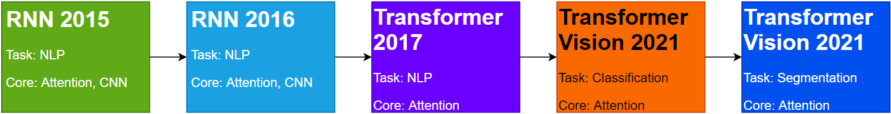
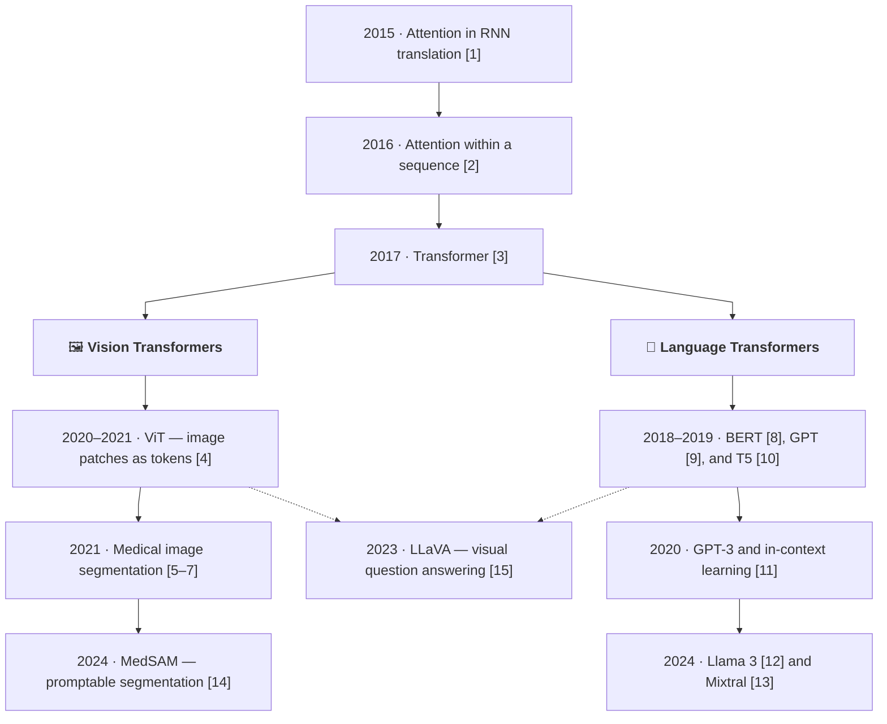

### Let you know the principle of AI models from excellent works
This post is an introduction to the Transformer, in terms of its origin, application and development.

##  RNN 2015
⭐ Sequence to sequence model with attention mechanism, to avoid forgeting too long vectors, compute each vector's weight (correlation) of decoder with all the vectors in encoder. Machine Translation, Natural Language Processing (NLP)    
📄 [Neural Machine Translation by Jointly Learning to Align and Translate](https://arxiv.org/abs/1409.0473), 2015
##  RNN 2016    
⭐ Self-Attention model, not limited in sequence to sequence model.   
📄 [Long Short-Term Memory-Networks for Machine Reading](https://arxiv.org/abs/1601.06733), 2016
##  Transformer 2017
⭐ Earlier models used attention alongside RNNs. The Transformer dropped the RNN and used attention to connect positions in a sequence. Those positions can represent words in a sentence or, as ViT later showed, patches of an image.    
📄 [Attention is all you need](https://proceedings.neurips.cc/paper/2017/file/3f5ee243547dee91fbd053c1c4a845aa-Paper.pdf), 2017
##  Vision Transformer 2021
⭐ It uses Transformer (encoder part) to do the image classification task. It split the image into small patches as input, and record the position infomation of each patch. It performs well if pretrained on large datasets (more than 100 million). Short for ViT.     
📄 [An Image is Worth 16x16 Words: Transformers for Image Recognition at Scale](https://arxiv.org/abs/2010.11929), 2021
##  Vision Transformer in segmentation 2021
⭐ It first uses Transformer to do the image segmentation task. At the same time, it combines the CNN in encoder part to better restore the low level information, in decoder part, it also uses CNN.    
📄 [TransUNet: Transformers Make Strong Encoders for Medical Image Segmentation](https://arxiv.org/abs/2102.04306), 2021-02-08    
📄 [Medical Transformer: Gated Axial-Attention for Medical Image Segmentation](https://arxiv.org/abs/2102.10662), 2021-02-21   
📄 [CoTr: Efficiently Bridging CNN and Transformer for 3D Medical Image Segmentation](https://arxiv.org/abs/2103.03024), 2021-03-04   
📄 [TransBTS: Multimodal Brain Tumor Segmentation Using Transformer](https://arxiv.org/abs/2103.04430), 2021-03-07    
📄 [UNETR: Transformers for 3D Medical Image Segmentation](https://arxiv.org/abs/2103.10504), 2021-03-18    
📄 [Pyramid Medical Transformer for Medical Image Segmentation](https://arxiv.org/abs/2104.14702), 2021-04-29     
📄 [Swin-Unet: Unet-like Pure Transformer for Medical Image Segmentation](https://arxiv.org/abs/2105.05537), 2021-05-12    
📄 [UTNet: A Hybrid Transformer Architecture for Medical Image Segmentation](https://arxiv.org/abs/2107.00781), 2021-07-02    
📄 [DS-TransUNet:Dual Swin Transformer U-Net for Medical Image Segmentation](https://arxiv.org/abs/2106.06716), 2021-07-12    
📄 [TransAttUnet: Multi-level Attention-guided U-Net with Transformer for Medical Image Segmentation](https://arxiv.org/abs/2107.05274), 2021-07-12    
📄 [UCTransNet: Rethinking the Skip Connections in U-Net from a Channel-wise Perspective with Transformer](https://arxiv.org/abs/2109.04335), 2021-09-09   
📄 [nnFormer: Interleaved Transformer for Volumetric Segmentation](https://arxiv.org/abs/2109.03201), 2021-09-07    
📄 [MISSFormer: An Effective Medical Image Segmentation Transformer](https://arxiv.org/abs/2109.07162v1), 2021-09-15              
📄 [Transformer-Unet: Raw Image Processing with Unet](https://arxiv.org/abs/2109.08417), 2021-09-17     
📄 [VT-UNet: A Robust Volumetric Transformer for Accurate 3D Tumor Segmentation](https://arxiv.org/pdf/2111.13300.pdf), 2021-11-26         
📄 [Advances in Medical Image Analysis with Vision Transformers: A Comprehensive Review](https://arxiv.org/pdf/2301.03505.pdf), 2023-01-10, 63 pages!      

👉 Acknowledgements: [Wang Shusen](https://youtu.be/aButdUV0dxI)

## Transformer Evolution at a Glance

## References

1. Bahdanau et al. (2015). [Neural Machine Translation by Jointly Learning to Align and Translate](https://arxiv.org/abs/1409.0473).
2. Cheng et al. (2016). [Long Short-Term Memory-Networks for Machine Reading](https://arxiv.org/abs/1601.06733).
3. Vaswani et al. (2017). [Attention Is All You Need](https://arxiv.org/abs/1706.03762).
4. Dosovitskiy et al. (2021). [An Image Is Worth 16×16 Words: Transformers for Image Recognition at Scale](https://arxiv.org/abs/2010.11929).
5. Chen et al. (2021). [TransUNet: Transformers Make Strong Encoders for Medical Image Segmentation](https://arxiv.org/abs/2102.04306).
6. Hatamizadeh et al. (2021 preprint). [UNETR: Transformers for 3D Medical Image Segmentation](https://arxiv.org/abs/2103.10504).
7. Cao et al. (2021 preprint). [Swin-Unet: Unet-like Pure Transformer for Medical Image Segmentation](https://arxiv.org/abs/2105.05537).
8. Devlin et al. (2018 preprint). [BERT: Pre-training of Deep Bidirectional Transformers for Language Understanding](https://arxiv.org/abs/1810.04805).
9. Radford et al. (2018). [Improving Language Understanding by Generative Pre-Training](https://cdn.openai.com/research-covers/language-unsupervised/language_understanding_paper.pdf).
10. Raffel et al. (2019 preprint). [Exploring the Limits of Transfer Learning with a Unified Text-to-Text Transformer](https://arxiv.org/abs/1910.10683).
11. Brown et al. (2020). [Language Models are Few-Shot Learners](https://arxiv.org/abs/2005.14165).
12. Dubey et al. (2024). [The Llama 3 Herd of Models](https://arxiv.org/abs/2407.21783).
13. Jiang et al. (2024). [Mixtral of Experts](https://arxiv.org/abs/2401.04088).
14. Ma et al. (2024). [Segment anything in medical images](https://doi.org/10.1038/s41467-024-44824-z).
15. Liu et al. (2023). [Visual Instruction Tuning](https://arxiv.org/abs/2304.08485).
